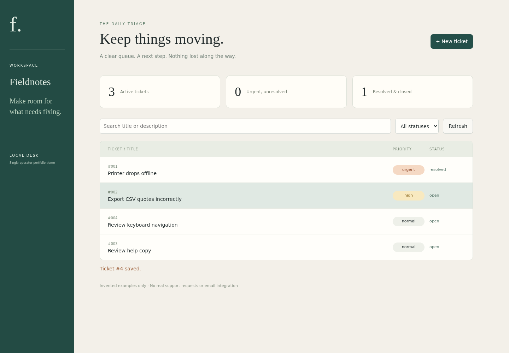
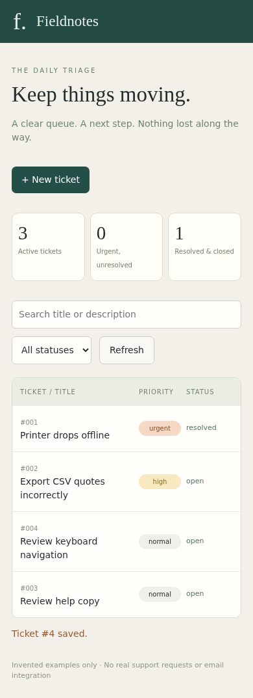

# Fieldnotes Service Desk

A local issue triage board with persistent tickets, priority queues, validated lifecycle transitions, search and an append-only status history.

## Quick start

```sh
uv sync --frozen
uv run python app.py
# Open http://127.0.0.1:8082
```
The database is created in instance/. Use invented issue descriptions only. Reset by stopping the server and removing instance/desk.db. No default credentials or accounts.

## Tests

`uv run python -m unittest discover -s tests -v`

## Scope and limitations

Single trusted local operator, intentionally no multiuser login. Loopback-only development server, CSRF/origin and host checks protect mutation endpoints. Do not deploy publicly; SQLite is unencrypted. Not an email/helpdesk integration or production ticket system. Status history cannot be edited through the API.

## Attribution and sample data

Built for Raj's portfolio with Wabi AI assistance. Sample data is invented and labelled synthetic; no real customer, employer or private account records are included. This is a learning/portfolio implementation, not a claim of commercial work or production deployment.

See source and tests for implementation decisions. Use invented data when exploring.

## How it works

Browser → loopback Flask JSON API → validated service layer → SQLite ticket + lifecycle history transaction. No multiuser accounts; host, origin, CSRF, CSP and parameterized SQL reduce local-web hazards.

## Verified example

Chromium created three tickets, progressed one through triage/in-progress/resolved, verified four history entries, searched/filtered/reloaded and checked HTML escaping; desktop/390px layouts inspected. API tests cover rejected transitions, absent CSRF and foreign origin.

See [VALIDATION.md](VALIDATION.md) for tested environments and scope.




